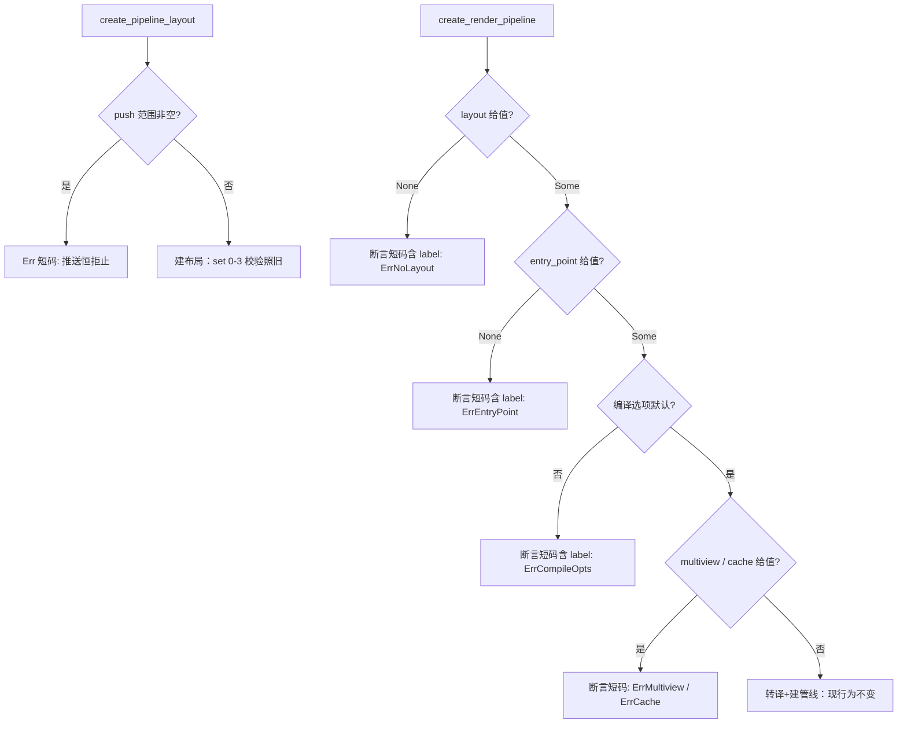

# 业务流程图（L1 · 按需）

## 源表（图是视图，表是源）
| 入口 | 判序 | 违约行为 | 合法路径 |
|---|---|---|---|
| create_pipeline_layout | 推送范围非空 → set 归属 | 短码失败（未建布局） | 现行为 |
| create_render_pipeline | layout 缺省 → entry_point → 编译选项 → 多视角 → 缓存 → 其余现行校验（与芯 create_rp_impl 断言序一致） | 断言含 label+短码（无半建管线） | 转译+创建照旧 |
