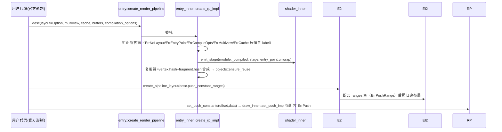

# 07-design/call-chain · 精简档（L7）

<!-- 本册承载：预期调用链（设计输入）+ 实现切片块清单 + 壳芯落地对账。契约住 src/ 壳注释（types/entry/draw 壳与 inner），本册不再复述，只给指针。 -->

## 预期调用链（sequenceDiagram · 设计时预期，非代码派生）

## 源表（链关键节点）

| 节点 | 契约所在（壳指针） | 拒止词汇 |
|---|---|---|
| 管线创建入口校验序 | src/entry/mod.rs create_render_pipeline 注释 · src/entry/entry_inner.rs create_rp_impl 头部断言组 | ErrNoLayout / ErrEntryPoint / ErrCompileOpts / ErrMultiview / ErrCache |
| 布局创建 | src/entry/mod.rs create_pipeline_layout 注释 · entry_inner create_pl_impl | ErrPushRange（范围非空） |
| 通道推送 | src/draw/mod.rs set_push_constants 注释 · draw_inner set_push_impl（恒拒止桩） | ErrPush |
| 描述符形制 | src/types/mod.rs（RenderPipelineDescriptor/VertexState/FragmentState/PipelineLayoutDescriptor/ShaderSource/PipelineCompilationOptions/PushConstantRange/ShaderStage/Limits） | — |
| 源换形转译 | src/shader/shader_inner.rs compile_impl（Wgsl=Cow、Glsl=单源带段标记；defines=TODO-DECL） | EmptyGlsl 已退役 |

## 实现切片（块清单 · 顺序）与落地对账

| 块 | 内容 | 状态 |
|---|---|---|
| S1 | types 壳词汇改造（+ShaderStage/PushConstantRange/PipelineCompilationOptions/PipelineCache 引用/Limits 新字段；退役 WgslSource/GlslSource/GlslVersion/GlslFragment/GlslVertex）。验收注记：S1–S3 间允许中间态不过全量 check，块级判据=「芯适配同批完成后 cargo check --lib 零错误」，全量 --all-targets 由 S4 末承担（验收粒度=批尾） | ✅ 落地 |
| S2 | entry 壳（PipelineCache 占位句柄 + 两处契约注释）、draw 壳 set_push_constants | ✅ 落地 |
| S3 | 芯机械适配：shader_inner 源分支换形+tests、entry_inner 断言组+buffers+layout/entry_point expect、shader/mod EmptyGlsl 退役、draw_inner 恒拒止桩、ShaderStages 补 Eq/Hash derive、limits_of 补 0 | ✅ 落地 |
| S4 | 复用键合成修复（vertex+fragment 哈希，防换段命中旧程序）；examples 两例换形制（分 stage 建模块、push_constant_ranges/&[]/Some(&layout)/buffers/multiview/cache） | ✅ 落地 |
| 核验 | cargo check --all-targets Finished 零错误；cargo test --lib 21 passed 0 failed 1 ignored（含 GLSL 单源 compile 过 + 语法错 Err 两用例——实证 `#version` 头自承载；缺头不设防=naga 默认版本回退，已注记于用例注释）；两例既存 drop-ref warning 属未触达行非新增。带窗运行回归（可见+稳定/渐变方块）待用户执行 | ✅（运行回归待用户） |

## 有意差异（对账面登记，非疏漏）

- SpirV/Naga/Dummy 变体不入公开面、带 `#[non_exhaustive]`（门禁拍板）。
- Glsl 段 stage 用本地 `ShaderStage` 而非 naga::ShaderStage（不泄 naga，芯内 match 映射）。
- VertexBufferLayout 不补 Hash/Eq/PartialEq derive（补齐传染 VertexAttribute/VertexStepMode/VertexFormat 整链——归后续全量对账批，与词汇对账正交）。
- 拒止走断言口径非错误值（沿用创建族合同；RenderPass 通道无标签源，ErrPush 消息以 offset/len 参数定位代 label）。

## 落地事故记录（可审计）

- PowerShell 5.1 `Get-Content/Set-Content` 往返把两例 main.rs 写坏（UTF-8 按 ANSI 重编码，换行受损）；`git checkout` 还原 + edit 工具重放 S4，最终 cargo 编译验证编码与内容有效。教训：PS 内联改写源码禁用，落文件只走 edit/write 工具。

## 遗留

已落地（实现批 2026-10-15，用户批准直做、不走 dev-impl）：
- defines 注入 naga GLSL 预处理 ✅（glsl_defines_apply_test 双向断言）
- entry_point=None 单入口自动选 ✅（pick_entry；唯一=采纳、缺失/歧义=Err(NoEntry)；缺失/歧义走既有出码失败断言路径；autopick+missing 两测试）
- ShaderStage→naga::ShaderStage 收敛为 From impl ✅（原 match 内联退役）
- 两例带窗运行冒烟 ✅（进程存活 4s 无崩溃、clear 帧输出正常；「可见」留目检）

仍遗留：
- 拒止断言的正式短错误码枚举/通道统一（当前断言消息内嵌短码字面）。
- Features 命名位表与官方全量对账（PUSH_CONSTANTS 恒 0 已隐式满足，未占位命名）。
- Limits/derive 全量对账批（VertexBufferLayout derive 等，见有意差异节）。
