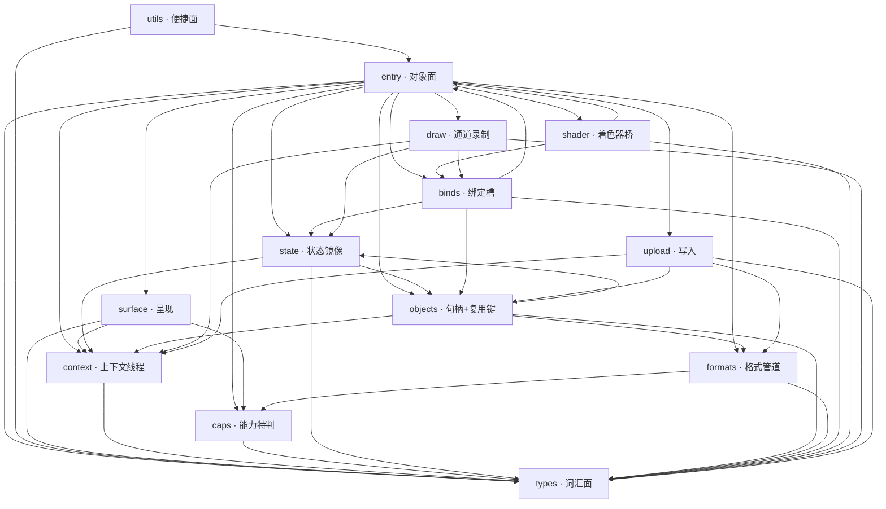
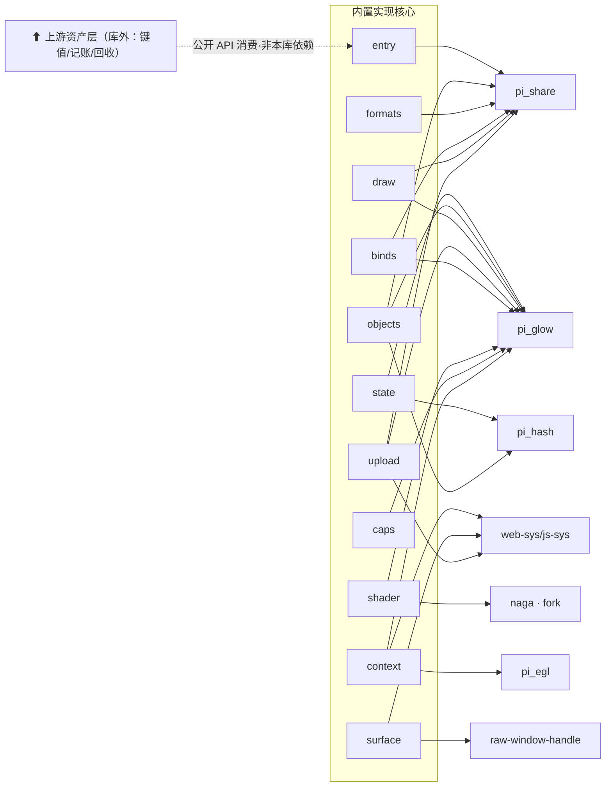
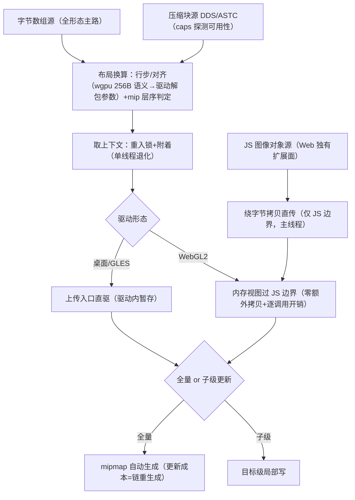
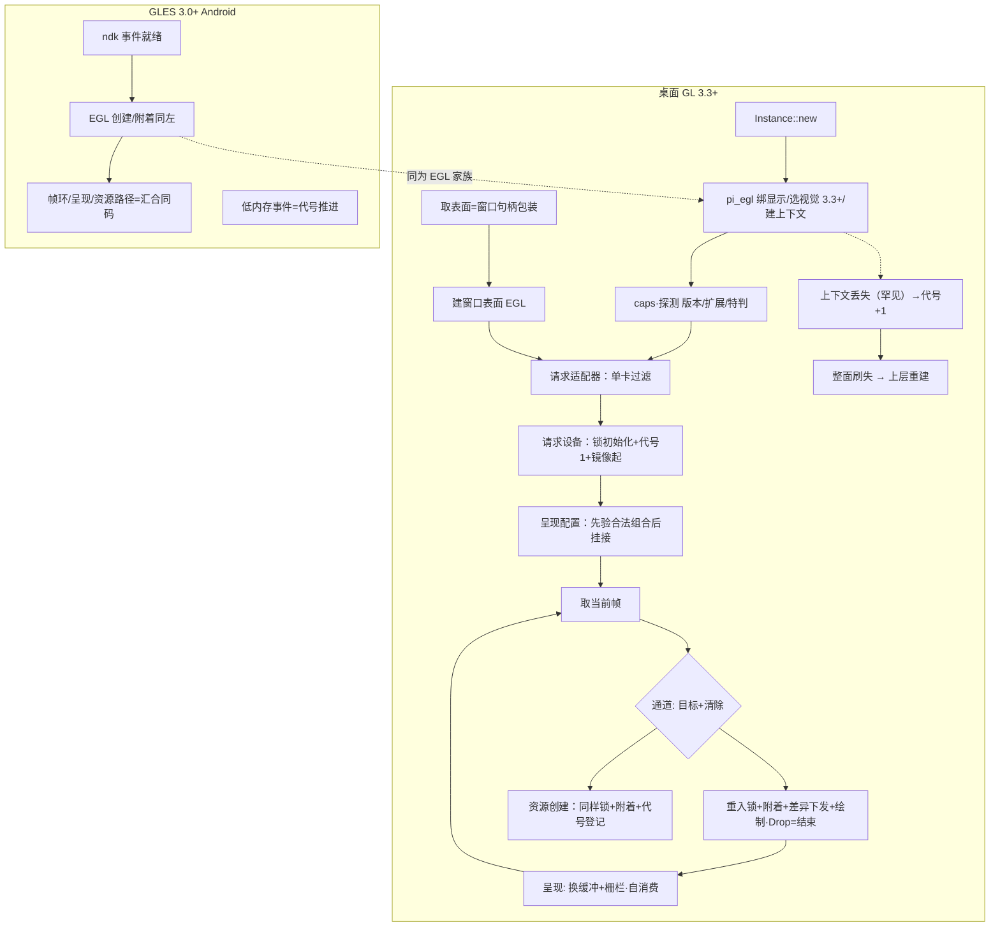
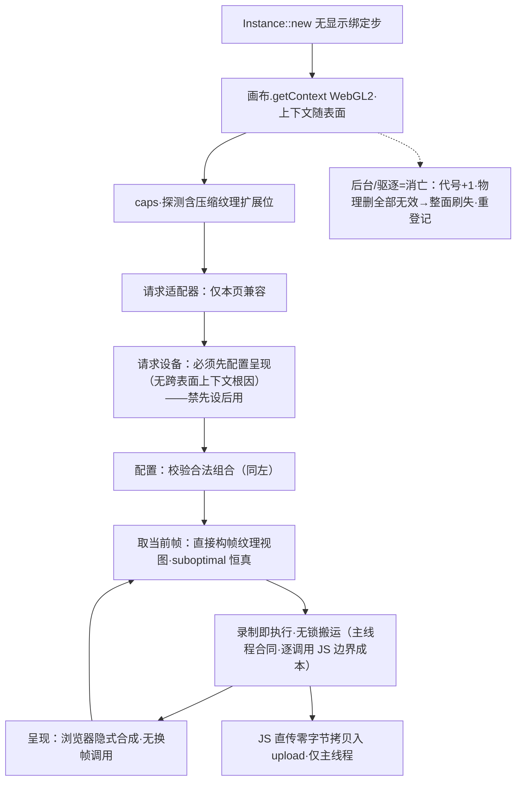
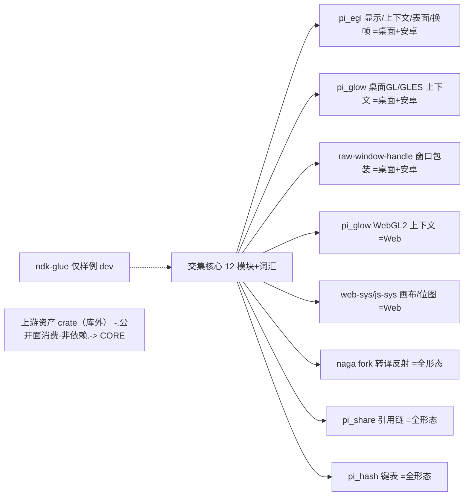

# pi-wgpu-rebuild · 依赖与图（L5 · 资产出库校准版）

<!-- 新工程无分层惯例（00-context：不采旧仓结构）→ 越级判据不适用。本册为源，图为画法，图随表改。 -->

## 依赖边 · 内层（实现 12 模块+types 词汇面=图 13 节点；本工程无分层惯例→越级判据不适用；单 crate 内类型互引允许，不计为功能环；计数口径同 modules 册顶注）

类型互引说明：单 crate 内存在双向类型引用（entry↔{binds,state,shader}、objects↔state、surface↔entry），Rust 单 crate 常态；叠合判据=「无功能环（调用链不成环，见 call-chain 册）+ 无越级」，类型互引不计环。

纠偏注记：上轮提案表「utils→entry/upload/types」+「entry→utils」实为假环——lib 伞面 re-export 是导出表非调用边，修正为 utils→{types,entry} 单向。

| 从 → 到 | 说明 |
|---|---|
| entry → types, surface, context, caps | 对象面词汇/附着/上下文/能力 |
| entry → state | 设备持状态镜像 |
| entry → formats | Texture 持驱动参数组 GlParams（写路径消费） |
| entry → objects, binds, shader, draw, upload | create_*/pass 编排 |
| utils → types, entry | 便捷构造消费公开对象面 |
| surface → types, context, caps | 配置校验用能力位、绑上下文 |
| context → types | — |
| caps → types | 探测结果填词汇 |
| state → types, context, objects | 镜像比较引用缓存与句柄刷失 |
| objects → types, context, formats | 创建/复用经格式转换 |
| objects → state | 死亡登记经 state 芯（死名表）+ 镜像引用作废 |
| formats → types, caps | 格式表即词汇层数据；门控读 caps 最近快照 |
| binds → types | 布局描述符 |
| binds → state, entry, objects | 应用经镜像差异下发；条目载对象句柄、对表布局 |
| shader → types, binds, entry | 反射登记对表管线布局 |
| draw → types, state, binds, context | 录制用镜像与应用绑定 |
| upload → types, objects, context, formats | 直写缓存对象 |

## 主依赖图（源=上表，节点边与表一一对）

## 依赖边 · 外部（库 ↔ crate，源表，含校准后边界）

| 从 → 到 | 说明 |
|---|---|
| state/objects/draw/upload/binds/shader/caps/context → pi_glow 0.13.3 | GL/GLES/WebGL2 统一函数入口，编译期选型 |
| context → pi_egl 0.2.3 [Win/Android] | Display/Context/换帧 |
| context/surface → web-sys/js-sys 0.3 [Web] | WebGL2 上下文获取；画布/离屏画布（cfg） |
| surface → raw-window-handle 0.6 [Win/Android] | 窗口附着 |
| upload → web-sys/js-sys [Web] | JS 图像直传私有扩展面（登记迁移差异清单） |
| shader → naga 25.0.1（本地 fork，wgsl-in/glsl-in/glsl-out） | 转译与反射 |
| entry/objects/formats/binds/draw/upload → pi_share 0.5.2 | 跨线程共享所有权（持有引用链原语） |
| state/objects → pi_hash 0.1.1 | 高速哈希表（复用键与镜像缓存） |
| entry → thiserror/log/bitflags/lazy_static/ordered-float/derive_more/profiling/codespan-reporting 等 | 通用基础 crate（crates.io，沿用旧清单版本） |
| ——边界线—— | **本库不依赖 pi_assets / pi_time**（资产出库校准）；ndk-glue 仅 examples dev 链；wgpu 25.0.* 仅 use_wgpu 对照可选 |

## 平台/外部汇合图（源=上表；虚线=生态非依赖）

## 实现路径分支汇合流（源=context/surface/caps 职责+外部边表）

```mermaid
flowchart TD
  S{"编译目标形态？"}
  S -->|"x86_64 桌面"| W1["pi_egl: 显示绑定→视觉配置→上下文 GL≥3.3"]
  S -->|"android"| A1["ndk 就绪事件→pi_egl GLES≥3.0"]
  S -->|"wasm32"| B1["画布取 WebGL2 上下文（无 EGL，上下文随表面）"]
  W1 --> M0["caps 探测：版本/扩展/特判登记"]
  A1 --> M0
  B1 --> M0
  M0 --> C1{"单线程合同？"}
  C1 -->|"单线程 feature"| C2["锁与搬运整体退化=零开销"]
  C1 -->|"默认"| C3["重入锁+调用附着、用毕让绑"]
  C2 --> Jn["汇合点：状态镜像启动→此后三形态同码（差异在 formats 转换表/caps 能力位）"]
  C3 --> Jn
  W1 -.->|"窗口句柄"| SV1["呈现配置：换帧挂接（三形态唯一合法组合）"]
  A1 -.-> SV1
  B1 -.->|画布 cfg| SV1
  SV1 --> Jn
```

## 驱动形态 × 差异矩阵（校准版；「汇合」=同码；原则线见决定⑥）

| 差异维度 | 桌面 GL | GLES | WebGL2 | 承担模块 → 隔离方式 |
|---|---|---|---|---|
| 上下文绑定/搬运 | EGL 逐线程附着 | EGL 同 | 浏览器隐式绑定无 EGL | context → 形态适配实现，合同不变 |
| 呈现换帧 | 换缓冲+Fence | 同 | 浏览器合成隐式 | surface → 呈现分形态 |
| 表面附着 | 窗口句柄库 | 同+ndk 就绪事件 | 画布 cfg | surface → 附着类型分支 |
| 着色器输出版本头 | GLSL ES 3.0（README「3.3」判过时→notes 修） | 同 | 同 | shader → 无差异（汇合） |
| 名→位置反射 | 有字符串查询但不用 | 块索引可用 | 块索引可用 | shader → 取交集能力 |
| 存储缓冲 | 有（不用） | 无 | 无 | types/binds → 全按 UBO 建模 |
| UBO/采样器/属性槽下限 | 驱动≥ | GLES 保证 | 浏览器≥ | binds → 写死 16（取下限，拍板） |
| 压缩纹理 DDS/ASTC | 原生常备 | 扩展常见 | 靠扩展探测 | formats+caps → 探测填能力表 |
| 浮点/深度可渲染 | 核心/原生 | 部分扩展 | 依赖扩展 | formats+caps 同上 |
| 删除时机 | 即删 | 即删 | 即删；**lost 时整面代号失效** | objects+state → 即删+刷失；Web 特有失效校验 |
| 显存记账/键值复用/收缩 | 出本库=上游资产层 | 同 | 同 | **库外**——problem OUT 已钉 |
| 写探针成本 | 低 | 低 | 高（渲染循环内） | upload/state → geterror 编译 feature |
| JS 图像对象直传 | 无 | 无 | 有（私有扩展） | upload → cfg 面（唯一公开分形态点） |
| 问题驱动特判 | 无 | 高通/小米 | iOS18/Safari | caps → 能力位集合勿散写 |

**交集原则（决定⑥）**：跨形态差异只经四道闸——caps 探测、formats/types 数据表、context/surface 附着适配、pi_glow 函数入口；state/objects/draw/binds/upload 只写交集 API，禁止形态 if。

## 上传/更新链流程图

考虑点（对齐换算/拷贝计数/高频小更新/Web 主线程限/越界兜底）按门禁记录入 L7 防御与调用链册展开；「上传与更新不拆模块」=同一写入时机决定（元判据）。

## 形态子图（L9 用户索图后补：逐驱动形态实现路径+逐形态依赖画法；源=差异矩阵+外部边表）

读图关键：三形态仅两处时序级差异（换帧附着步有无；配置与请求设备的先后），余皆汇合于交集核心——此即 L7 调用链一套图不分形态的由来（call-chain 已注）。

## 地基接法注（pi_glow / pi_egl 真实接口清单——定稿后用户追问补录，本机扫描为据）

### pi_glow 0.13.3（glow fork）
- 入口=`glow::Context` 单一类型，cfg 选型 native（桌面 GL+GLES 同构）/web_sys（WebGL2）——**交集原则的物质层**：下涉模块芯只写 HasContext 函数面，零形态分支。
- 句柄别名=glow::{Shader,Program,Buffer,Texture,VertexArray,Framebuffer,Renderbuffer,Sampler} 等=<Context as HasContext> 关联类型；壳 GlHandle(u32) 为占位表示，**实现批改 glow 关联类型（壳签名不变=合法表示替换）**。
- 消费边：state/upload/draw/objects/formats/binds/shader/caps/context 各芯全经此层下发 GL。

### pi_egl 0.2.3
- 关键面（src/instance.rs 实核）：实例 create_context()->Result、make_current(...)、swap_buffers(&Surface)；platform 子目录（windows/android）出显示/配置/窗口表面；gl.rs=取函数地址桥给 glow。
- 消费边：**仅** context 芯（attach/let_go=make_current/释放+锁骨架；present 桌面/安卓=swap_buffers 底座）与 examples 生命周期接线；**Web 形态整体不经 pi_egl**（无 EGL，上下文随画布，cfg 隔离）。
- 版本锁注：registry=yn 声明（发布批）；本机验证=path 依赖 0.2.3 编译过。

### 模块→API 对位表（实现批对账用）

| 芯桩 | 接法（真实 API 名进伪码） |
|---|---|
| context::attach_impl | 桌面/安卓：实例创建→选择配置→create_context→make_current 绑线程；Web：画布取 WebGL2 上下文（无 egl 步） |
| context::let_go_impl | 再 make_current(None)（unmake 让绑他线程——设计笔记 §4 三段式） |
| surface::present_impl | 桌面/安卓：swap_buffers(表面)+栅栏记位；Web：无调用（隐式合成）——形态差异此芯收口 |
| surface::get_current_impl | 取后缓冲；底层错→映射四态（Web=lost 检查，失效→gen_bump） |
| objects/state/draw/upload/binds/formats/shader/caps 各芯 | 一切驱动调用=glow Context 的 HasContext fn；句柄=glow 关联类型；取址经 pi_egl gl 桥 |
| entry_impl request_adapter | 枚举=egl 查询（单卡）；软件 adapter 断言拒绝 |

### 门控对位表（pi_glow/pi_egl 各自环境分支靠什么——本机 Cargo/library 实核 2026-10-13）

| 层 | 开关 | 默认 | 对应环境 | 本库关系 |
|---|---|---|---|---|
| pi_glow | **无 [features]** | — | native.rs=桌面 GL+GLES 共用 Context（cfg not(wasm32)∥emscripten）/ web_sys.rs=WebGL2（cfg all(wasm32,not(emscripten))）——纯 target cfg 选型 | 我们零 action；句柄/函数面两边同签名=交集层成立的原因 |
| pi_egl | swappy=[] | off | 安卓 vsync 帧调度（present 走 swappy 链） | 暂不开（Fifo 合同已覆盖需求⑬；开=变更点行，surface present 芯接线时定） |
| pi_egl | shared-stdcxx=[] | off | 安卓 c++ STL 共享链接 | 链接期选项，examples/apk 构建批判定 |
| pi_egl | fps=[] | off | 平台帧率统计（诊断向） | 与本库 FR-15 探针重叠=不开（避免双轨计数源） |
| pi_egl | platform 目录（windows/android/**web**） | cfg 选 | 三平台实现分目录；web=emscripten 风 EGL 仿真层 | **本库 Web 形态不走 egl 路径**（画布直取上下文，差异矩阵⑩行钉死）；platform/web 永不接入 |
| 本库自身 | gl/use_wgpu/single_thread/geterror/webgl_context/webgl(裸 cfg --cfg 注入) | — | 语义开关=实现批芯内 cfg(feature) 接线（判⑩留痕） | gl=manifest 名；single_thread=context 芯退化；geterror=upload 芯 wasm 探针；webgl_context=state/pipeline 行为分支（相-2） |

结构结论：**地基两 crate 不带环境 if**（glow 零 feature 纯 target；egl 平台目录=cfg 非 feature）；三形态差异在我们层按差异矩阵四道闸收口——本表为对账总闸，被否=「在库内对 glow/egl 加 feature 包装层」（地基已按 target 分好，再包=第二套门控，散落风险回归）。
