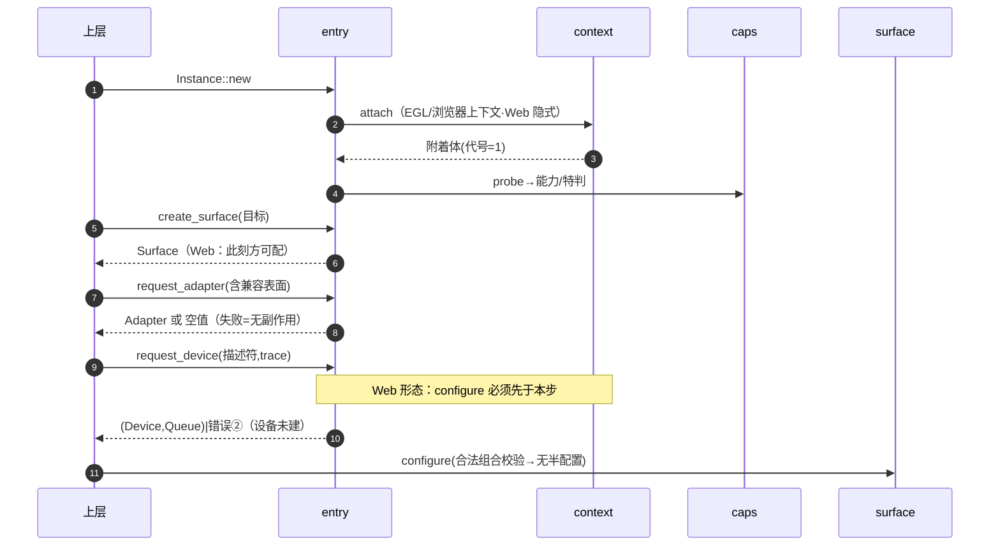
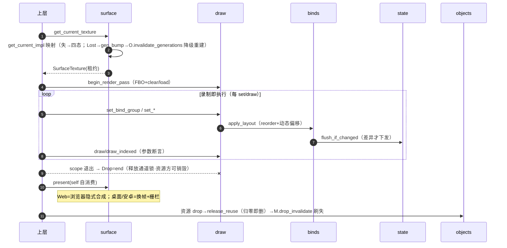

# pi-wgpu-rebuild · 预期调用链（L7 · 设计输入，非代码派生）

| 行为 | 节点序列 | 路径 |
|---|---|---|
| 初始化 | entry.Instance::new→context.attach→caps.probe→entry.create_surface→entry.request_adapter→entry.request_device→surface.configure | 失败②③=结果值；configure=断言前全量校验无半配置 |
| 每帧 | surface.get_current_texture→draw.begin→(set_*→flush_if_changed)→draw.draw→Drop→surface.present | 失=四态（lost→链8）；present 类型级不可能重 |
| 建管线 | entry.create_render_pipeline→shader.compile_to_es300→shader.emit_stage→objects.ensure_reuse（命中++/建+登记） | 源错=短错误码上递（决定⑪）、无半项 |
| 建资源（1:1） | entry.create_texture→formats.to_gl_params→直建 | 越界=断言 |
| 绑定应用 | draw.set_bind_group→binds.apply_layout（reorder→偏移→下发）→state.flush_if_changed | 计数不符/槽满=断言，绑定未变 |
| 删除 | 对象 drop→objects.release_reuse（归零）→驱动删→死名登记→state.flush 强发并整面销记 | 违约=未定义画面（合同） |
| 写 | upload.write_texture→convert_upload_layout→context.attach→驱动入口→formats.mip_convert | 违约=错误码 log（debug 不下发/release 留痕+下发） |
| lost 失效 | get_current_texture 捕获→context.gen_bump→旧句柄/镜像随代号失配集体退场→上层重走 request_device | 降级=重配置；账面由上层资产层处理 |
| 外部干扰 | entry.reset_state→state 重探测→flush | 无失败态 |
| 着色器 | shader.compile_to_es300→shader.reflection_register→objects.ensure_reuse | 源/布局错=短错误码上递（决定⑪）、log 诊断 |
| 便捷面 | utils.create_buffer_init→entry.create_buffer+upload | 同上游契约 |

闭包核对（2026-10-13 L9 对账修订）：11 链节点均解析到壳实名；链号=首表行号、1 基。例外三类：Queue::submit/Encoder::finish=空壳契约本身不入链；write_texture_jsbuffer=链7（写）的 JS 旁路源；get_capabilities 与 Adapter 查询族=纯查询无链叙事价值。其余公开操作≥1 链引用。

形态路径分叉注（L9 补）：链1「初始化」在 Web 形态=「必须先配置呈现」再「请求设备」（与桌面/安卓相反）；链2 在 Web 无换帧调用。换帧/附着细节见 deps 形态子图。

## 图画法（源=上表；两图）

### 链1·初始化（sequenceDiagram）

### 链2·每帧（sequenceDiagram，含链4/6/7 挂点）

## 实现切片 · 块清单（2026-10-13 返工补 · L7 同册产物）

有序块清单——实现者按「做一块 → 检查 → 测 → 下一块」推进，禁止一上来全做。每块=芯文件内落地，壳与注释冻结（契约漂移=违规）。检查点通用项：cargo check 相对基线零新增错误 + 该块公开单元壳注释与 api/errors 册对拍零漂移。

| 块 | 目标单元（芯） | 前依赖 | 块内验收（除通用检查点） | 对接链 |
|---|---|---|---|---|
| B0 | 基线对账：lib/types 词汇面现状确认，examples 冒烟骨架立项 | — | 全量 cargo check（默认+single_thread+geterror 三 feature 组合）绿 | — |
| B1 | context 芯：attach / let_go / gen_bump（pi_egl+pi_glow 接线按 deps 门控对位表，swappy 等 cfg 无第二套；锁超时 try_lock_for=断言+trace） | B0 | 三形态路径分叉注落地：桌面/安卓 EGL 附着、Web 隐式；代号单调增可测 | 链1·1-2步 |
| B2 | caps 芯：probe / fill_impl（扩展表→能力位 DDS/ASTC/浮点；特判集合只动这里） | B1 | attach 后即探；iOS18/Qualcomm 位可读 | 链1·probe |
| B3 | formats 芯：to_gl_params / mip_convert（格式表=词汇层数据；DDS/ASTC 直载能力查 caps 位） | B2 | 抽样格式对表；越界=断言 | 链4 |
| B4 | objects 芯：直建三类+四种复用键（ensure_reuse / release_reuse / invalidate_generations；XHashMap 复用缓存；归零即删+刷失单向） | B1,B3 | 计数命中++/建+登记；归零物理删；代号失配=死用断言 | 链3/链6/链8 |
| B5 | state 芯：StateMirror 字段集 + flush_if_changed / drop_invalidate（仅驱动成功后改镜像；对象死=强制失效） | B4 | 差异才下发可测（同值重复 set 零下发） | 链5 |
| B6 | binds 芯：alloc_slots / apply_layout / consume_dynamic_offsets（16 槽定长+每管线 reorder；预检计数不符/槽满/死句柄=断言且绑定未变） | B5 | reorder→偏移→下发闭环（apply=镜像差异下发；consume=计数校验+游标前移）；反射表对接留 B7（pipe=程序侧保留位，本批只用存在性） | 链5 |
| B7 | shader 芯：compile_to_es300 / reflection_register / emit_stage（naga wgsl-in/glsl-in/glsl-out；产物持 IR，出码延到管线创建） | B6 | 语法/校验错=短错误码上递+log 诊断（不吞）；反射 (set,binding)→类别/名落地；按入口出 ES300 | 链10 |
| B8 | upload 芯：write_buffer / write_texture / convert_upload_layout / jsbuffer（即时下发；越界 debug 断言 / release 记录+GL 兜底不谎报；256B 行步换算） | B4 | FR-15 trace 留痕路径可测；Web 位图直传零拷贝 | 链7 |
| B9 | surface 芯：configure_impl / get_current_impl / present_impl / capabilities_impl + context_inner::{surface_attach, surface_swap}（先全量校验=无半配置；底层错→封闭四态；present 自消费；Web 无换帧、桌面/安卓换帧+栅栏；suboptimal 恒真） | B1,B2 | 链2 全帧循环桌面形态可跑通（配 B11）；Lost→gen_bump→旧对象使用全断言、request_device 重入重建 | 链2/链8 |
| B10 | draw 芯：begin_render_pass + set_* 族 + draw / draw_indexed + Drop=end（单颜色目标恰一；录制即执行经镜像差异；viewport 坐标内翻=汇合层；first_instance/base_vertex=0 断言） | B5,B6 | Drop 后资源方可销毁合同成立；参数违约=断言无副作用 | 链2/链5 | 
| B11 | entry 芯：Instance/Adapter/Device/Queue 编排全链（new→attach→probe→…→configure；create_* 隔离带一次校验含 desc.label；request_adapter None=无副作用；request_device 错=设备未建；finish/submit 空壳不扩语义） | B7,B9,B10 | 链1+链4 冒烟=examples 出第一个可运行程序（补 R10 遗留坑） | 链1/链3/链9 |
| B12 | utils 芯：create_buffer_init / create_texture_with_data（纯组合调用无新契约）/ env 助手恒 GL 语义（WGPU_BACKEND 不生效=登记差异）/ 锁包装 | B11 | 便捷面与直调等价 | 链11 |
| B13 | 相-2 use_wgpu 挂接：lib compile_error 替换为 wgpu 依赖面 + impl PiWgpuAdapter for wgpu::Adapter 委托 lib_inner::uw_request_impl（单参→双参、trace 丢弃；官方面无自有芯） | B0–B12 | A/B feature 对照编译（待落地清单 C 项验收） | 伞面 |
| B14 | types 词汇全量对表：85 项对 wgpu 25.x 裁剪登记（api 册顶注载荷声明；显式登记断裂进迁移清单，禁静默） | B11 | 对表清单落 changes；链上 25 结构零破坏 | 全部 |

并行注记：B3/B5/B6/B7 芯相互独立（依赖前块仅为接口面存在，非实现依赖），可按人手机动并行；主序线 B1→B2→B4→B9→B10→B11 不可乱序。

