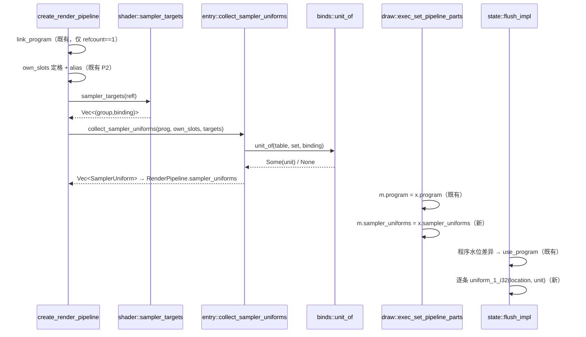

# sampler-unit-assign · 预期调用链 + 实现切片（L7）

## 预期调用链（设计输入，非从代码派生）



## 伪码骨架（示意·不可验证）

```text
sampler_targets(refl):
  输入前提: refl 为管线创建期已登记的表
  主流程: 取 kind==Texture 的条目 → 打包 (group,binding) → 去重 → 升序
  分支: 无纹理条目 → 空表
  失败/降级: 无（纯函数）
  后置状态: 无副作用

unit_of(table, set, binding):
  输入前提: table 为创建它的管线那份
  主流程: 扫描 domain_array(table, Texture) 求 pack(set,binding) 命中下标 i → bind_base(set, i)
  分支: 扫描无命中 → None（不得走 lookup_slot——其未命中即断言）
  失败/降级: None 上递，由调用方决定记不记码
  后置状态: 不改 table

collect_sampler_uniforms(prog, table, targets):
  输入前提: prog 活句柄；处在 GL 段内
  主流程: 枚举 active uniforms → 解析 _group_G_binding_B_<stage> 前缀取 (G,B)（容忍 stage 后缀）
            → (G,B) 命中 targets 才查 location → unit_of 求 unit → 按**名字**逐条收 (location,unit)
  分支: 前缀不匹配 → 静默跳过；unit_of=None → log::error!(短码) 跳过；location<0 → 跳过
  去重规则: 不按 (G,B) 去重（VS/FS 同绑定 = 两条 uniform、两个 location，去重即丢半）
  失败/降级: 整体不失败，返回已收集部分
  后置状态: 驱动绑定态不变

flush 程序分支:
  if water.program != m.program:
      use_program(m.program)
      for u in m.sampler_uniforms: uniform_1_i32(u.location, u.unit)
      water.program = m.program
      // 指位只挂本分支；set_program 直发点（state_inner.rs:514-520）不附指位——
      //   两发点之间无绘制命令，且水位未被直发推进 → flush 必重发并指位（见 data.md 不变量 1）
      // 指位无失败分支：入表前提为活程序 + location>=0，水位照常推进，不设重试
```

## 实现切片（做的顺序；一块=一条可独立验的端到端行为）

| # | 块 | 独立判据 | 涉及单元 |
|---|---|---|---|
| 1 | `sampler_targets` 落地 | 给定含 1 纹理 + 1 采样器 + 1 UBO 的反射表，返回恰 1 条且为纹理的 (group,binding)；空反射表返回空 | shader |
| 2 | `unit_of` 落地 | 同一 (set,binding) 在两套不同次序槽表下得到各自单元；且与 `apply_impl` 实绑单元一致 | binds |
| 3 | `collect_sampler_uniforms` 落地 | 真 GL 测试：含采样的 ES300 程序链接后表非空、location>=0、unit 与槽表算出的相同；**并含「VS 与 FS 同采一图」用例 → 得两条 location、unit 相同**（关 L0 待验证动态面与 L9 关键坑 1） | entry |
| 4 | 三段字段接通（管线持表 → 持行体 → 镜像） | 建两条布局不同的管线，切换后 `m.sampler_uniforms` 各自正确 | entry/record/draw/state |
| 5 | flush 程序分支指位 | 需求 1 的测试：2×2 纯色纹理 + 采样 quad 绘制回读中心 = 源色（容差 0） | state |
| 6 | 共用程序不同布局对照测试 | 需求 2：两次绘制各取自己的源色，互不串台 | 全链 |
| 7 | 产品 + shadow_cube 回归 | 需求 3、4：产品出画（宫格存在亮格）、shadow_cube 均值差 <= 1、无新增错误日志 | 全链 |

> 顺序约束：1→2→3 自底向上（后者依赖前者的返回）；4 依赖 3 的产物类型；5 依赖 4；6、7 是收口验证。
> 实现者做一块→检查→测→下一块，不一上来全做。
